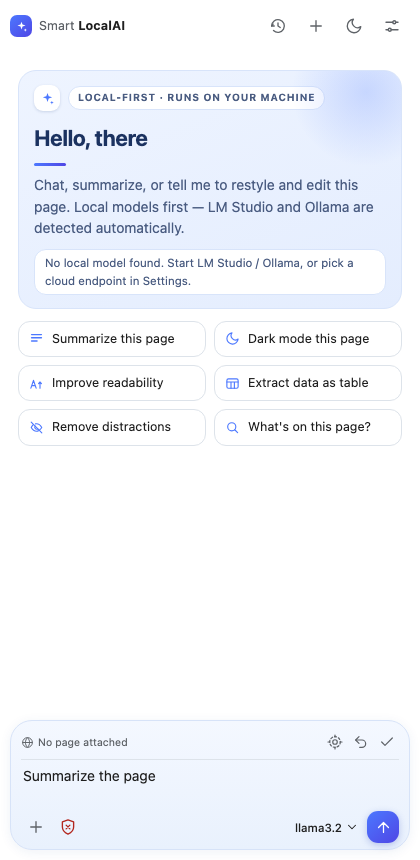
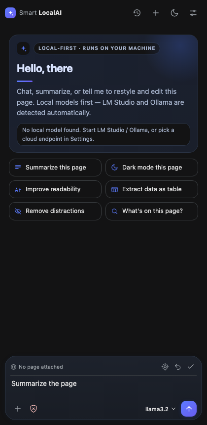
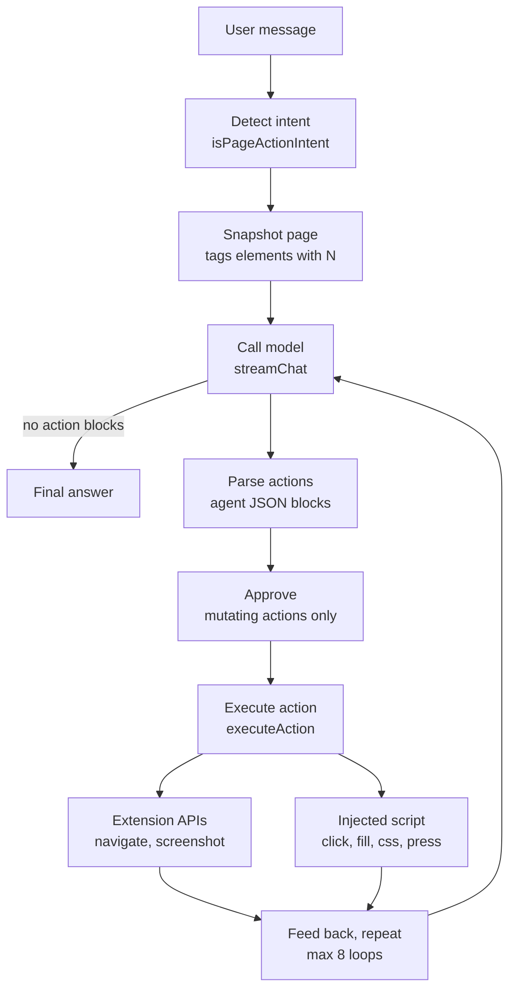

# Smart LocalAI

Chrome Sidebar extension — chat & page agent like Claude for Chrome / Google Ask Gemini. Chat in the sidebar, and let the model restyle or edit the current page with Chrome's built-in AI, LM Studio, Ollama, or any LLM endpoint. The sidebar UI is built with React and Vite.

**Website:** https://nvkudva.github.io/Smart-LocalAI/ · **Privacy policy:** [PRIVACY.md](PRIVACY.md) (published at https://nvkudva.github.io/Smart-LocalAI/privacy.html)

## Build and load unpacked

1. Run `bun install` and `bun run build`.
2. Open `chrome://extensions`, enable **Developer mode**.
3. Click **Load unpacked**, select the generated `dist` folder.
4. Click the toolbar icon (or `Ctrl/Cmd+Shift+Y`) on any page.

For development, run `bun run dev`, then rebuild before reloading the unpacked extension. Run `bun test` for the regression suite and `bun run lint` for the linter.

To produce the uploadable package, run `bun run package` — it builds `dist/` and zips it as `smart-localai-<version>.zip`.

## Screenshots

| Light | Dark |
|---|---|
|  |  |

## Models

- **Built-in (if available):** Settings → Built-in model uses Chrome's on-device Gemini Nano. Free, no key. Enabling it disables the endpoint card.
- **Endpoint card:** pick a provider (LM Studio, Ollama, Anthropic, OpenAI, DeepSeek, Gemini, Custom). URL prefills and stays editable. Enter the API key, press **Refresh models**, pick a model or leave Smart pick. Your model choice is remembered per provider.
- Model pill switches model any time, with per-model reasoning effort. Keys live only in `chrome.storage.local`.

## Page agent

- Mode **Agent** (default): say `make headings blue`, `hide the cookie banner`, `change the CTA text to Buy now`. The model emits action blocks; each shows as a card with payload.
- **Safe mode** (default on): mutating actions need **Apply**. Turn off in Settings for auto-apply. Read-only actions run free.
- Actions: `apply_css`, `edit_text`, `set_html`, `click`, `fill`, `press`, `remove`, `highlight`, `scroll`, `navigate`, `screenshot`, `run_js`. Any selector can be replaced by `{"ref":N}`, the numbers in the page outline.
- `screenshot` sends the visible tab to vision models on the next step.
- **◎ Pick** — click any element on the page to target it. **↩ Undo** rolls back edits (stack kept in page). **Page ✓** toggles whether page text/DOM outline is sent as context.
- Suggestion chips: Summarize, Dark mode, Readability, Extract data, Remove distractions.
- Right-click: *Ask Smart LocalAI* on selected text, *Summarize this page* on any page.
- Blocked on `chrome://` and Web Store pages (Chrome forbids scripting there); chat still works.

### How the agent loop works

Code: `src/app/useChatLoop.js` (loop), `src/page/pageAgent.js` (parse and execute), `src/page/injectedPage.js` (in-page actions).

## Cool extras

- **Page citations** — facts from the page render as `[1]` buttons; click one to scroll the page to that passage.
- **Attachments** — images (vision models), PDFs (Claude/Gemini), and code/text files ride along with your message.
- **Prompt library** — type `/` for built-ins plus your own saved prompts with `{selection}` and `{page}` placeholders.
- **Threads** — searchable history, per-chat export to Markdown/CSV, one-click clear (with confirm).
- **Auto Summary** — optional 3-line summary the moment a new page opens.
- **Idle reset** — a panel left open for 10 idle minutes starts a new chat; the old one stays in history.
- **Permissions** — the extension asks for `<all_urls>` only so local endpoints (LM Studio/Ollama on localhost) and page injection work everywhere; keys never leave your machine except to the endpoint you chose.

## Project layout

| Path | Job |
|---|---|
| [src/app/App.jsx](src/app/App.jsx) | App state, persistence, menu and settings wiring |
| [src/app/useChatLoop.js](src/app/useChatLoop.js) | Send, streaming, citations, page-action iterations |
| [src/chat](src/chat) | Composer, messages, markdown, attachments, history and prompt menus |
| [src/models/providers.js](src/models/providers.js) | Provider registry, Nano, detection, smart model scoring |
| [src/models/streamTransports.js](src/models/streamTransports.js) | Protocol-specific streaming (OpenAI, Ollama, Anthropic, Gemini, Nano) |
| [src/models/useEndpoint.jsx](src/models/useEndpoint.jsx) | Endpoint state, detection, model selection |
| [src/page](src/page) | Snapshot, intent, action executor, picker and undo |
| [src/settings](src/settings) | Settings drawer, advanced section |
| [src/threads/useThreads.js](src/threads/useThreads.js) | Thread history CRUD and export |
| [src/shared](src/shared) | Constants, storage, header, icons, styles, endpoint state |
| [public/manifest.json](public/manifest.json) | MV3 manifest copied into `dist` |
| [public/background.js](public/background.js) | Opens panel, context menus and pending prompts |
| [docs](docs) | GitHub Pages site (landing page + privacy policy) |

See [PLAN.md](PLAN.md) for architecture and rejected alternatives.
